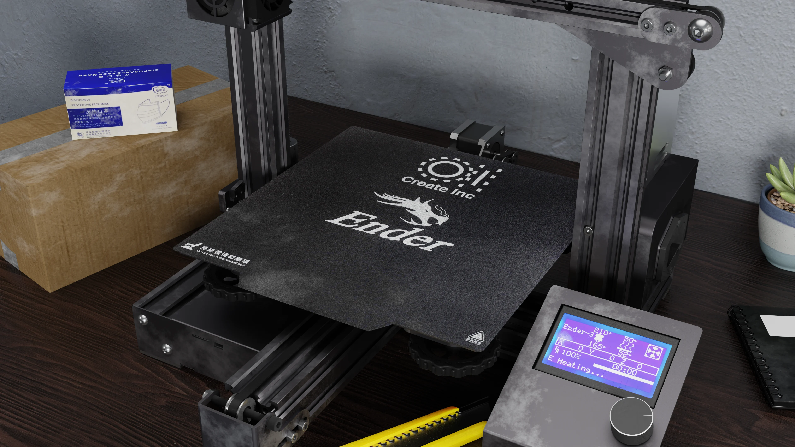
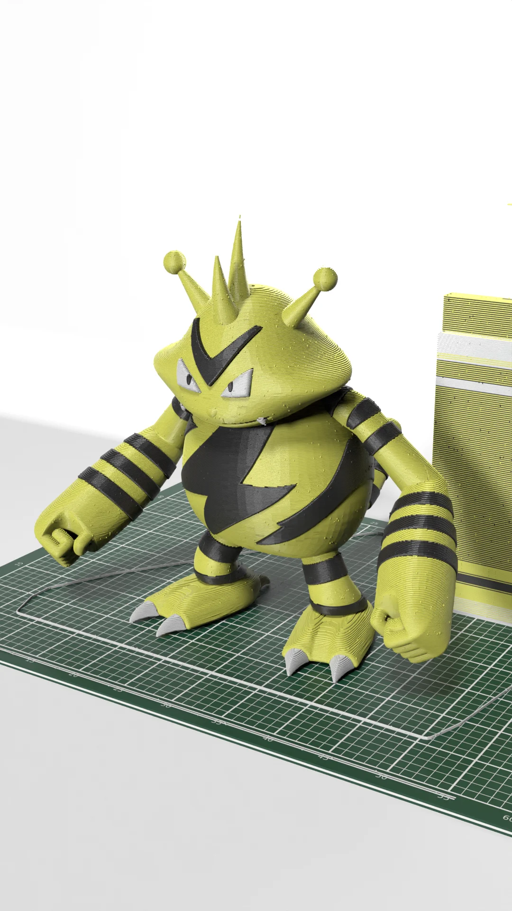
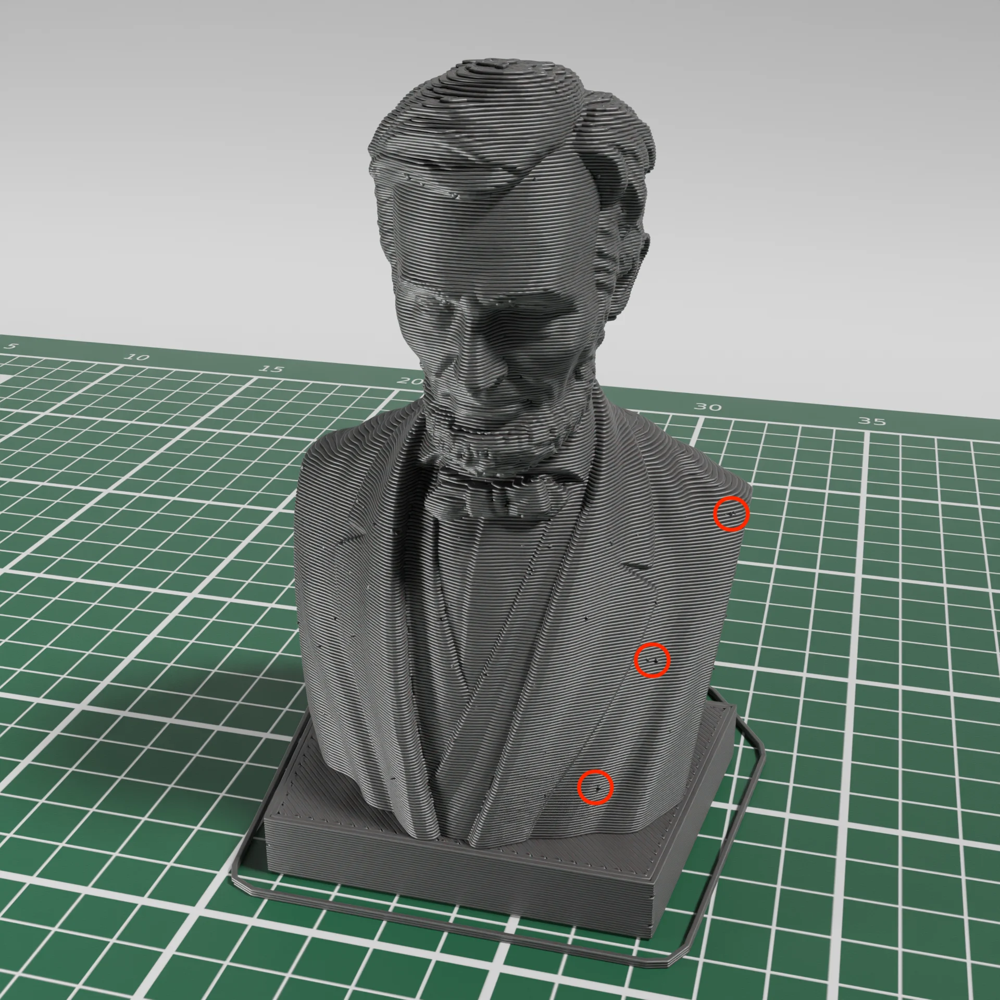
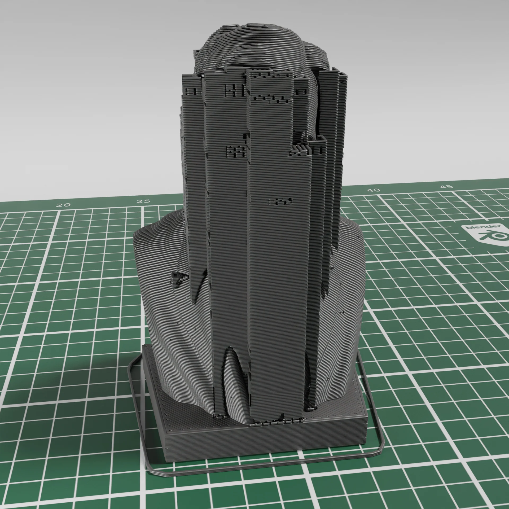

# Stitch3r Project 2.0

## Introduction

Stitch3r Blender addon is the culmination of years experience with 3D printing and the unique challenges that 3d printing products creators face. Stitch3r allows you to create perfect visualisations and timelapses with just a couple clicks.

## Mission Statement

The purpose of this addon is to make 3D printed product visualisation realistic and beautiful. Blender is a great way to achieve product visuals of all sorts. Not everybody has the necessary skills to use Blender to create visuals for their product. But as long as the product is 3D printed. I can help. Join me in this lovely journey. New and exciting updates are being added every single week.

## Thank You

Thank you to all the supporters who have supported me in my strive to deliver a fantastic product.

## Docs

Complete docs are available [here](https://stitch3r-wiki.createinc.dev/)
It explains everything in detail

# Stitch3r — GCode Renderer for Blender

This is Blender addon even a Blender newbie can use. We have customers that knew nothing about Blender but still managed great renders.

It takes PrusaSlider, OrcaSlicer or BambuStudio GCode, processes it and converts it into a renderable 3d model. It takes into account various heights and widths of the GCode and delivers a very realistic looking model.

For the full guide, please visit the [Wiki](https://stitch3r-wiki.createinc.dev/)

Please watch the launch (video)[https://youtu.be/MLZJUBB3Pdk] for some tips and tricks:

## Testimonials

.webp>)
.webp>)
.webp>)

## Features

- Includes material, the bottom plate, lights and set

- Comes with a realistic printer scene and more will be coming in the future:
  

- Truly one-click processing: 
  
  Just select a valid PrusaSlicer or OrcaSlicer sliced GCode file and let the addon worry about the rest.

- Select the feature types you want to see/render:
  

- Multimaterial Support
  

- Create 3D printing timelapses by just keyframing a single property:
  

- Add realistic blobs and errors:
  

- To Support or Not to Support?
  
